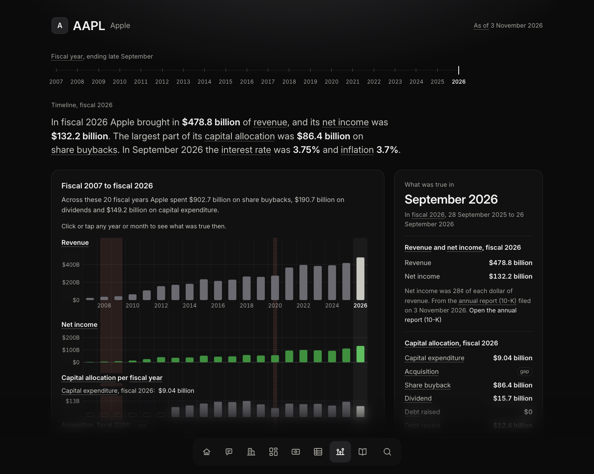
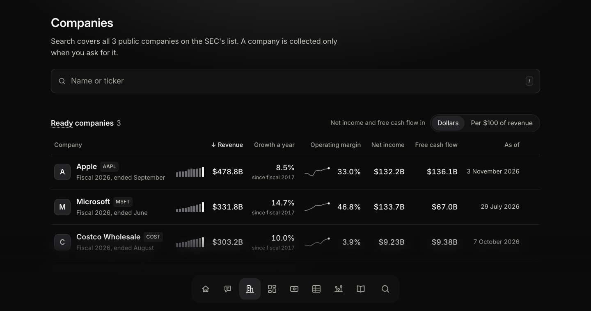

# Fundamental Analysis

A local tool for understanding how a public company works by looking at its numbers, its decisions and the world around it, all on one timeline.


## Why it exists

To make it possible to understand 100 US-listed public companies in a short time, starting with no background in fundamental analysis.

It is not a course. It teaches through how it is built: clear visuals, numbers you can move and compare, and the same plain words everywhere. Using it should be enough to learn how a company's finances fit together.

## What it covers

- US-listed public companies that file an annual report (10-K). Banks, insurers and property trusts are not covered yet.
- Any such company, collected when you ask for it. There is no fixed list.
- What each company reported in its filings, year by year.
- Where each dollar of revenue goes.
- What the company did with its money, and the notable things that happened to it.
- What the economy was doing at the time. What the industry and share prices in general were doing comes later.

## What it looks like

**Where the money goes.** Each dollar of revenue followed to what it was spent on and what was left.


**Statements.** The income statement, balance sheet and cash flow statement for the last ten fiscal years, with the change from each year to the next.


**Timeline.** Click any year or month to see what the company reported then, what it did with its money, and what interest rates and inflation were.



**Companies.** Every collected company side by side, in a table that sorts.



Each company also has an Overview, and every word underlined on a screen opens its meaning from the [glossary](./GLOSSARY.md).

These pictures come from the small extracts of Apple's, Microsoft's and Costco's filings that the tests use, so they carry no logos. `task readme:pictures` takes them again.

## Start it

You need [Bun](https://bun.com) and [Task](https://taskfile.dev).

```sh
task init
task dev
```

Then open http://127.0.0.1:4100. The first time, the tool asks for [your contact details for the SEC](#your-contact-details-for-the-sec). Apple, Microsoft, Costco, Tesla and NVIDIA are then collected on their own, so the home page has something to show.

To ask questions, sign in to ChatGPT once with `bunx codex login` in the tool's folder. If you already use Codex on this computer and signed in with ChatGPT, there is nothing to do: the tool uses that sign-in.

## Where it runs

Entirely on your own machine. There is no account and no service to sign up for. The internet is used to collect a company's filings from the SEC and the economic figures that go with them, and to answer questions. Everything already collected works offline.

Questions about a company are answered with your own ChatGPT subscription, through the Codex that comes with the tool. Each question, and the figures the tool looks up for it, goes to OpenAI; the collected data stays on your machine.

## Your contact details for the SEC

The SEC asks every program that reads its data to name the person sending the requests. The tool asks for a name and an email address the first time it fetches the company list, keeps them on this computer, and sends them only to the SEC.

To give them without that dialog, for example on a machine that runs the tool unattended, set both:

```sh
export SEC_CONTACT_NAME="Your Name"
export SEC_CONTACT_EMAIL="you@example.com"
```

Bun also reads them from a `.env` file in this folder, which is never committed:

```
SEC_CONTACT_NAME=Your Name
SEC_CONTACT_EMAIL=you@example.com
```

Both are needed together. The dialog wins over the environment: details given or changed there are the ones the tool uses.

## What it is not

- It gives no advice on what to buy or sell.
- It does not forecast.
- It is not a replacement for reading the filings. It is a faster way into them.

## Status

The first version is being finished. Collecting, the Companies list, the four company screens, the Glossary and questions all work. What is left before publishing is in [`todo.md`](./todo.md).

It is open source under the [MIT licence](./LICENSE). The typefaces, Inter and Newsreader, are under the SIL Open Font Licence.

## Rules that follow from being open source

- Everything the tool is built on must have a licence that allows it to be shared under MIT.
- The repository holds code and documents only. It never holds collected filing data, share prices, index values, company logos, or screens from other products. Each person collects their own data when they run the tool, and the tool fetches each collected company's logo from Wikidata onto that computer.
- No secrets, personal settings or references to private work are committed.
- Nothing here is investment advice.

## Where things are

| File or folder                   | What it holds                                                                                           |
| -------------------------------- | ------------------------------------------------------------------------------------------------------- |
| [`GLOSSARY.md`](./GLOSSARY.md)   | The official words of the project, in the order to learn them. The tool uses these words and no others. |
| [`field-map.md`](./field-map.md) | A short map of the field: what it is called, what it includes, and where the data comes from.           |
| [`todo.md`](./todo.md)           | The work to reach the first version, in order, with a check for every task.                             |
| [`docs/rfc/`](./docs/rfc/)       | Open questions and ideas being explored. Start with its README.                                         |
| [`docs/adr/`](./docs/adr/)       | Decisions that were made, and why. Each one is a short file.                                            |

## Tasks

Commands are run through [Task](https://taskfile.dev).

| Command                | What it does                                                        |
| ---------------------- | ------------------------------------------------------------------- |
| `task`                 | Lists every task                                                    |
| `task doctor`          | Checks the tools the project needs, without changing anything       |
| `task init`            | Installs what the project depends on                                |
| `task dev`             | Starts the tool at http://127.0.0.1:4100                            |
| `task collect -- AAPL` | Collects one company from the SEC and prints where its money goes   |
| `task check`           | Looks for problems without changing any file                        |
| `task fix`             | Applies the automatic fixes                                         |
| `task test`            | Runs the tests                                                      |
| `task screens`         | Compares pictures of the money flow with the saved ones             |
| `task screens:update`  | Saves new pictures of the money flow, after looking at what changed |
| `task readme:pictures` | Takes the pictures in this README again                             |
| `task build`           | Builds the tool                                                     |
| `task ci`              | Runs everything that must pass before work is handed over           |

The rules behind these names are written at the top of [`Taskfile.yml`](./Taskfile.yml).

## How ideas become decisions

1. A question or an idea is written down as an RFC in `docs/rfc/`.
2. It is explored through research, a quick prototype, or discussion.
3. What was learned is written back into the RFC as its outcome.
4. If the outcome is a decision that would be hard to change later, it is also recorded as a short ADR in `docs/adr/`.
